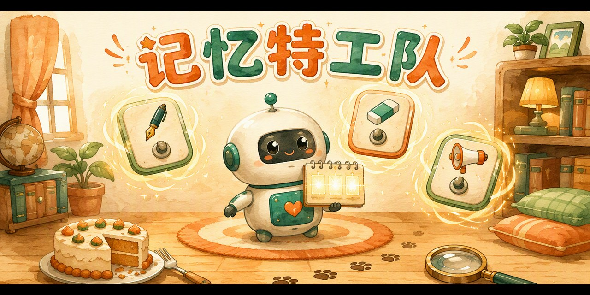

# 🕵️ Memory Agent · 记忆特工队

一个给孩子玩的 **LSTM（长短期记忆）启蒙网页游戏**——1997 年，科学家给 AI 发了一个「小本本」，AI 从此有了记忆力。

**👉 点这里直接玩：<https://pulj26pulj26.github.io/memory-agent/>**

## 怎么玩

机器人小忆只有一本 **3 页的小本本**，记不下所有东西。你是它的「记忆特工」，由你来决定：

1. **✍️ 记住门**——每句话听完，判断「值不值得记」：干扰信息坚决不占地方
2. **🧽 遗忘门**——本子满了要擦掉一页；信息过时了要擦掉旧的、写上新的
3. **📢 说话门**——提问环节只能照本子回答，本子上没有就老实说「我没记下来」

**三关任务：**

- 第一关 · 小狗旺旺的日常 —— 学会挑重点记
- 第二关 · 小明的苹果 —— 苹果一路搬家，学会及时更新
- 第三关 · 谁偷吃了蛋糕 🍰 —— 用本本上的线索破案！

通关集齐三枚徽章（记忆新星 → 更新高手 → 记忆侦探），领取「记忆特工证书」📜

> 💡 游戏里的三个开关，就是真实 LSTM 的**输入门、遗忘门、输出门**。孩子决定「什么该记、什么该擦」的那一刻，就是在做 LSTM 的工作——**会忘，才会记**。

## 特点

- 📱 手机、电脑都能玩，双击打开或点开链接即可
- 🔌 单个 HTML 文件，零安装、无需联网
- 🧠 游戏机制对应真实的 LSTM 门控原理
- 👧 适合 7-14 岁孩子，配套【和孩子一起学AI】社群「AI十哲」第三课

## 本地运行

下载 `index.html`，双击用浏览器打开即可。

## 系列游戏

| 课程 | 游戏 | 仓库 |
| --- | --- | --- |
| 第一课 · 图灵测试 | 《真人还是 AI》 | [human-or-ai](https://github.com/pulj26pulj26/human-or-ai) |
| 第二课 · 感知机 | 《教机器认苹果》 | [apple-or-not](https://github.com/pulj26pulj26/apple-or-not) |
| 第三课 · 长短期记忆 | 《记忆特工队》 | **memory-agent**（本仓库） |

---

*和孩子一起学AI · AI十哲系列* —— 把经典 AI 论文变成孩子能玩的游戏。

---

# 🕵️ Memory Agent

A kid-friendly web game about **LSTM (Long Short-Term Memory, 1997)** — the little notebook that gave AI a memory.

**👉 Play now: <https://pulj26pulj26.github.io/memory-agent/>**

## How to play

Xiao Yi the robot has only a tiny **3-page notebook**. You are its Memory Agent:

1. **✍️ Input Gate** — after each sentence, decide: worth remembering or not?
2. **🧽 Forget Gate** — when the notebook is full, erase a page; when facts change, update them
3. **📢 Output Gate** — answer questions only from the notebook; if it's not there, honestly say "I didn't write it down"

**Three missions:**

- Level 1 · Wangwang the Puppy — learn to pick what matters
- Level 2 · Xiaoming's Apple — the apple keeps moving; keep your notebook up to date
- Level 3 · Who Stole the Cake 🍰 — crack the case with the clues in your notebook!

Earn three badges (Memory Star → Update Master → Memory Detective) and your Memory Agent Certificate 📜

> 💡 The three switches in the game are LSTM's real **input, forget, and output gates**. The moment a child decides "what to remember and what to erase" — they're doing LSTM's job.

## Features

- 📱 Works on phones and desktops — just open the link
- 🔌 One single HTML file, no install, works offline
- 🧠 Game mechanics map to real LSTM gating
- 👧 Designed for kids aged 7-14

## Run locally

Download `index.html` and double-click it.

*Part of the "AI Classics for Kids" series — turning landmark AI papers into games children can play.*
